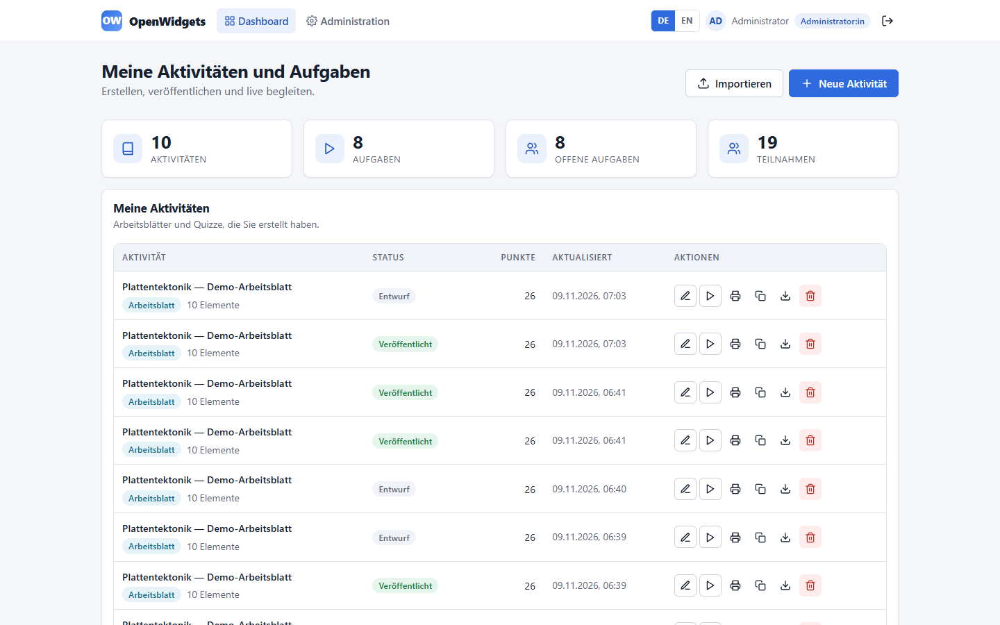
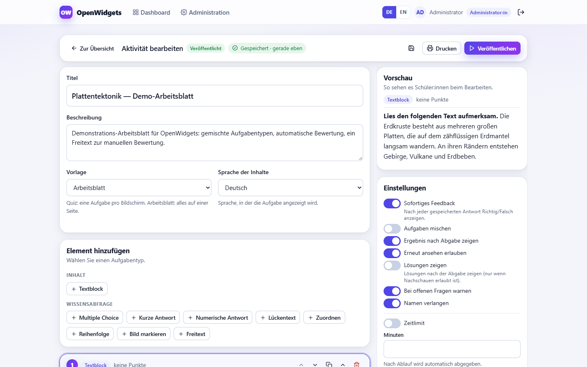
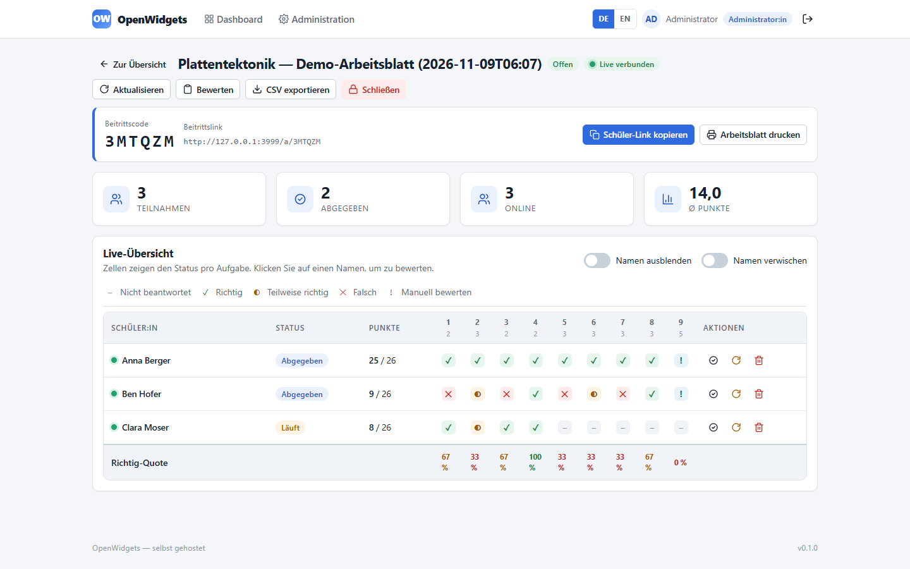
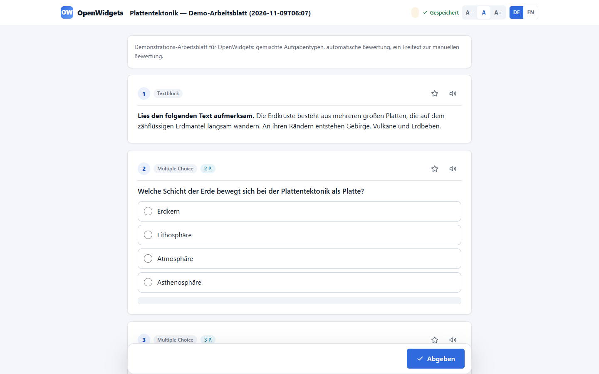
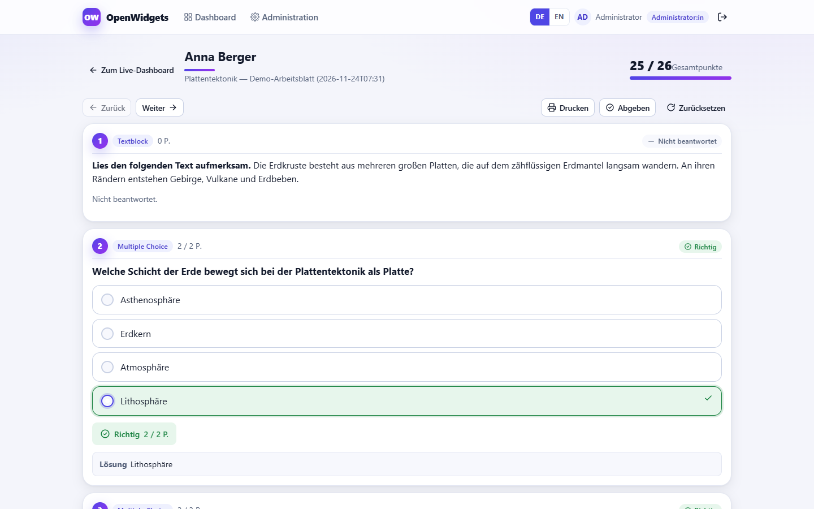
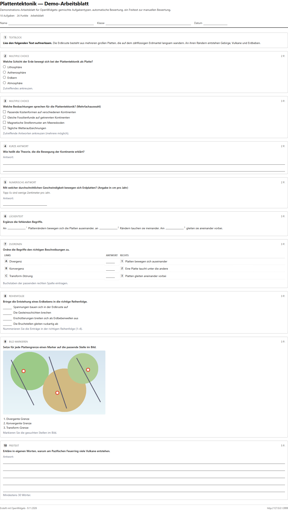

# OpenWidgets

**A self-hosted, open-source alternative to [das proprietäre Originalprodukt](https://www.das proprietäre Originalprodukt.com) for schools — designed to run on a single small LXC.**

Teachers author interactive quizzes and worksheets, students complete them in any browser (no accounts needed), grading is automatic where possible, and a live dashboard shows the class at work. Everything — database, uploads, answer keys, student responses — stays on your own server.

- **Status:** v0.1.0 — functional MVP, built and verified in this repository. Not yet battle-tested in a full school year.
- **License:** AGPL-3.0-or-later
- **Runtime:** Node.js ≥ 22.5 (Node 24 recommended), **zero npm runtime dependencies**, no build step
- **Footprint:** ~2 vCPU / 2 GB RAM / 16 GB disk for a whole school

> Honest framing: this is not a 1:1 clone of das proprietäre Originalprodukt' 40+ widget types. It deliberately implements the daily 80% — quiz/worksheet authoring, automatic grading, live monitoring, printing, import/export — with a much simpler architecture. See [the critical evaluation of the original research](docs/CRITICAL-EVALUATION.md) for the reasoning and the trade-offs.

## Screenshots

| Teacher dashboard | Authoring editor |
| --- | --- |
|  |  |

| Live class monitoring | Student worksheet |
| --- | --- |
|  |  |

| Manual grading | Print / paper fallback |
| --- | --- |
|  |  |

All screenshots are generated from a real browser run of the app (`tools/e2e/screenshots.mjs`); no mockups.

---

## Quick start (development)

```bash
# 1. Start the server (Node 22.5+; no npm install needed)
ADMIN_EMAIL=you@school.at ADMIN_PASSWORD='at-least-10-chars' npm start

# 2. Open http://localhost:3000 and sign in as the teacher
```

Without env vars, create the first admin account separately:

```bash
node scripts/create-admin.mjs --email you@school.at --name "Your Name" --password "at-least-10-chars"
npm start
```

Data (SQLite database + uploaded images/audio) lives in `./data` by default. Change it with `DATA_DIR=/var/lib/openwidgets`.

### Windows laptop (double-click, no terminal needed)

**Fastest way to try it:** double-click **`start-demo.bat`** — it starts a clearly-flagged demo instance with login **`admin` / `admin`** and four ready-made activities, each with a join code:
- Plattentektonik worksheet (image markers, fill-in-the-blanks, matching, ordering, long answer)
- Plattentektonik quiz (one question per screen)
- Mathematik — Brüche und Prozente
- Deutsch — Rechtschreibung und Grammatik

`start-demo.bat --reset` starts the demo from scratch. For a normal test instance with your own admin account, double-click **`start-openwidgets.bat`** instead (first run asks for email/name/password; `seed-demo.bat` optionally loads two more demo activities).

Both launchers keep their data under `%LOCALAPPDATA%\OpenWidgets\...` (deliberately outside OneDrive), detect the local Node.js and print the LAN URL for pupils. Firewall notes, limits and troubleshooting: [docs/RUN-ON-WINDOWS.md](docs/RUN-ON-WINDOWS.md). Use this for testing and the teacher workflow; use the LXC for actual classroom pilots (HTTPS, backups, 24/7).

### Demo content

Want to see the tool with realistic content instead of an empty dashboard?

```bash
# with the server running and an admin account created
ADMIN_EMAIL=you@school.at ADMIN_PASSWORD='...' node scripts/seed-demo.mjs --base-url http://127.0.0.1:3000
```

This creates two activities (a 10-item worksheet covering every item type, and a short quiz),
uploads a generated diagram for the image-pin item, publishes both and prints their student
join codes. Safe to run repeatedly; it only creates new activities.

## What works (v0.1)

### Teacher side

- **Dashboard** — create, duplicate, delete, import and export activities; list and manage assignments.
- **Authoring editor** — declarative block editor with live preview, per-type forms generated from item metadata, autosave, and optimistic-concurrency conflict detection.
- **10 item types** with deterministic auto-grading (see table below).
- **Publish** — creates an assignment with a 6-character join code and URL (printable, copyable, iframe-embeddable).
- **Classes (Lernpfade)** — bundle assignments into a class with its own join link (`/c/<CODE>`, also as QR code). Choose **free order** (everything open) or **fixed sequence** where each worksheet unlocks the next once the previous one is submitted — optionally requiring a minimum score percent. Students join the class with just a name and see a lobby with locked/open/done states.
- **Student accounts (class roster)** — the teacher enters student names in a class; each student gets a unique username + a generated one-time password (shown once, printable/CSV; resettable). Students log in at `/login` (tab „Schüler:in“), see „Deine Aufgaben“ on the landing page, and their attempts are linked to their account. Anonymous join-by-code keeps working.
- **Practice mode** — per activity/assignment: attempts are not graded, excluded from results/dashboard/CSV, and students can retry freely ("Erneut versuchen").
- **QR codes** — join links (assignment `/a/<CODE>`, class `/c/<CODE>`) rendered as scannable SVG QR codes in the teacher UI, generated locally (no external service).
- **Live dashboard** (SSE) — presence per student, live score, per-item state grid, per-item class heatmap, anonymize mode for projecting, force-submit / reset / remove participants.
- **Grading** — manual scoring and feedback for free-text items; totals recompute automatically; teacher sees the full student response.
- **Print** — worksheet (with optional answer key) and student result sheets, print-to-PDF via the browser.
- **Admin** — manage teacher accounts, instance stats.
- **Export** — CSV of all submissions (Excel-friendly), JSON export/import of activities.

### Student side

- Join by short code or link — **no student account, no email, no password**.
- Class lobby (`/c/<CODE>`) — join a class bundle by name, see all worksheets with locked/open/done badges, open the next one from the lobby.
- Worksheet (single scroll) or Quiz (one question per screen) layouts.
- Responsive, touch-friendly, keyboard-operable — tablets, Chromebooks, phones, desktops.
- Autosave per answer + offline retry queue (answers survive a dropped Wi-Fi connection and are re-sent when it returns; grading happens on the server).
- Instant feedback per question (optional), question starring, text-to-speech, font-size control.
- Result and review screen after submit — visibility controlled by the teacher (`showResults`, `allowReview`, `showAnswers`).

### Item types

| Type | Auto-graded | Notes |
| --- | --- | --- |
| Text block | ✅ (with `<<gaps>>`) | markdown-lite (`**bold**`, `*italic*`, lists), tables (`| a | b |`), inline images (``, paste with Ctrl+V), and inline gaps `<<answer|alt>>` that make it scoreable |
| Multiple choice (single/multi) | ✅ | Partial credit for multi-answer |
| Short answer | ✅ | Multiple accepted answers, case/punctuation-insensitive |
| Numeric answer | ✅ | Absolute/percent tolerance, German and English decimal input |
| Fill in the blanks | ✅ | Synonym lists per blank, proportional partial credit |
| Matching pairs | ✅ | Each side can be text, image or audio; dropdown-based (accessible); partial credit |
| Ordering | ✅ | Up/down buttons (no drag required); exact or per-position credit |
| Image pins | ✅ | Click targets on an uploaded image, tolerance radius |
| Label boxes on image | ✅ | Draw editable rectangles on an image (paste with Ctrl+V); students type the word into each box or drag words from a word bank; partial credit per box |
| Long answer | Manual (+ keyword hint) | Keyword hints suggest points; teacher decides |

## Production deployment (single LXC)

See **[docs/DEPLOY-LXC.md](docs/DEPLOY-LXC.md)** for the full guide (Proxmox unprivileged LXC, both Docker Compose and native systemd paths, Caddy + TLS, backups, upgrades, DSGVO notes).

**Auto-update from GitHub:** install a systemd timer once and the server updates itself whenever you push to `main` (sha-pinned download, health check, automatic rollback — data in `DATA_DIR` is never touched). See **[docs/AUTO-UPDATE.md](docs/AUTO-UPDATE.md)**.

Minimal production shape:

```bash
# inside the LXC (Debian 12)
apt install -y nodejs caddy        # or use the provided Docker image
DATA_DIR=/var/lib/openwidgets PORT=3000 ADMIN_EMAIL=admin@school.at ADMIN_PASSWORD='...' \
  node server/index.js
```

| Env var | Default | Purpose |
| --- | --- | --- |
| `PORT` | `3000` | HTTP port |
| `HOST` | `0.0.0.0` | Bind address |
| `DATA_DIR` | `./data` | SQLite DB + uploaded assets |
| `ADMIN_EMAIL`, `ADMIN_PASSWORD`, `ADMIN_NAME` | — | Seed the first admin on first boot only |
| `BASE_URL` | inferred | Public URL used in share links |
| `TRUST_PROXY` | `0` | Set to `1` behind Caddy/nginx |
| `SESSION_TTL_DAYS` | `14` | Teacher session lifetime |
| `MAX_UPLOAD_MB` | `10` | Upload limit per asset |

## Backups and retention

```bash
node scripts/backup.mjs --out /var/backups/openwidgets     # consistent SQLite snapshot + assets
node scripts/restore.mjs --from /var/backups/openwidgets/openwidgets-<timestamp> --yes
node scripts/prune.mjs --older-than-days 365 --dry-run     # DSGVO/Löschkonzept retention preview
```

The backup script uses SQLite `VACUUM INTO` (safe on a live instance). Restore requires the service to be stopped and moves the current database aside first. `deploy/backup.sh` wraps this for cron/systemd timers; `deploy/restore.sh` for recovery. For retention, administrators can also use `POST /api/admin/purge` (`{olderThanDays, dryRun}`) against a running instance.

## Architecture in one paragraph

A single Node.js process serves the API (`/api`), the teacher and student UIs, and shared ES modules. Persistence is SQLite in WAL mode plus a local assets directory — no Redis, no Postgres, no MinIO, no Kubernetes. Live updates use Server-Sent Events (not WebSockets) because traffic is one-way teacher-bound and a school's concurrency fits comfortably on one process. Answer keys are stripped from every student payload; all auto-grading runs on the server. The full engineering contract is [docs/CONTRACT.md](docs/CONTRACT.md).

```text
Browser (native ESM, no build)
  ├─ /a/<CODE>            student player (renderer modules)
  ├─ /teacher/...         teacher SPA (authoring, live, grading, admin, print)
  └─ /shared/...          pure modules (item schemas, scoring, util) shared with Node
Node 24 single process
  ├─ server/index.js      routing + static + security headers
  ├─ server/api/*          REST endpoints, SSE stream, assets
  ├─ shared/items/*        declarative item types: validate + score + sanitize
  ├─ server/db.js          SQLite schema (users, activities, assignments,
  │                        participants, responses, events, assets)
  └─ DATA_DIR/             openwidgets.db + assets/
```

## Security & privacy by design

- No third-party requests from the browser (no CDNs, no analytics, no fonts) — enforced by CSP `default-src 'self'`.
- Teachers: scrypt password hashes, HttpOnly SameSite session cookies, rate-limited login, same-origin checks on mutations.
- Students: anonymous random tokens per assignment (only SHA-256 hashes stored server-side).
- Answer keys never leave the server until the teacher explicitly enables `showAnswers` after submission.
- No HTML injection: teacher/student content is rendered as text (markdown-lite for formatting); uploaded SVG is rejected.
- Data residency is the point: all student data stays on the school's LXC. See DSGVO notes in the deployment guide.

## Testing

```bash
npm test                     # 63 unit + API integration tests (node:test, zero deps)
node tools/e2e/api-check.mjs # 50 end-to-end API assertions incl. answer-leak checks
npm run e2e                  # 14 Playwright browser specs (teacher/student/live/grade/admin/print/security)
```

Browser tooling is dev-only under `tools/e2e` (Playwright + Edge/Chromium); the application
itself never needs `npm install`. Screenshots in this README are generated by
`node tools/e2e/screenshots.mjs` against a seeded instance.

## Documentation

| Document | Contents |
| --- | --- |
| [docs/CRITICAL-EVALUATION.md](docs/CRITICAL-EVALUATION.md) | Fact-check of the das proprietäre Originalprodukt research and critique of the proposed architecture |
| [docs/DEPLOY-LXC.md](docs/DEPLOY-LXC.md) | Step-by-step LXC deployment, TLS, backups, DSGVO notes, troubleshooting |
| [docs/RUN-ON-WINDOWS.md](docs/RUN-ON-WINDOWS.md) | Double-click test setup on a Windows laptop (launcher, firewall, limits) |
| [docs/CONTRACT.md](docs/CONTRACT.md) | Engineering contract: item schemas, API, security rules |
| [docs/ACCESSIBILITY.md](docs/ACCESSIBILITY.md) | Honest accessibility statement: what was implemented, tested, and is known to fall short |
| [docs/USER-RESEARCH.md](docs/USER-RESEARCH.md) | Archived original research (input, not endorsed) |

## Roadmap (deliberately cut from v0.1)

LTI 1.3 Advantage (Moodle/Canvas gradebook passback) · QTI 3.0 / H5P import-export · rich-text items with a sanitizer · QR codes · image annotation with typed labels · more item types (crossword, hotspot-choices, tables) · optional AI drafting via any OpenAI-compatible endpoint (no cloud default) · multi-language UI beyond DE/EN.

## License

AGPL-3.0-or-later. You may self-host and modify freely; if you run a modified version as a network service, you must offer the source to its users.
